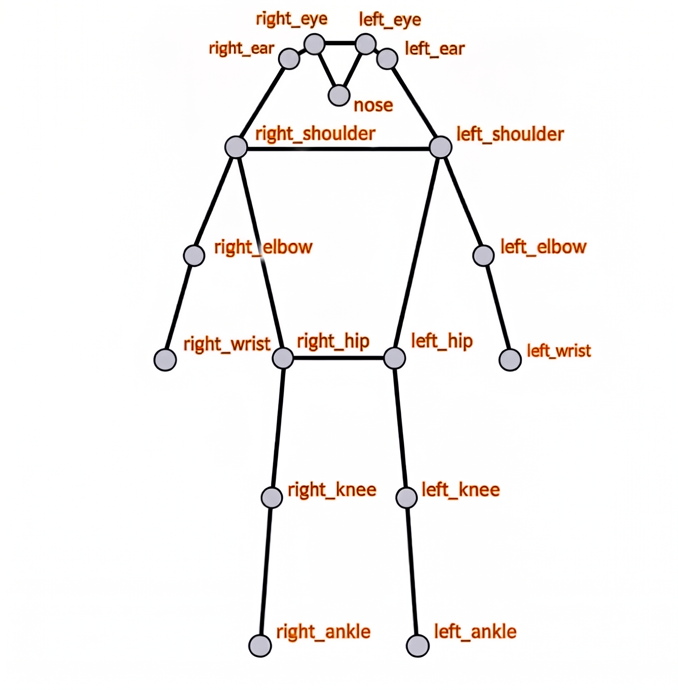
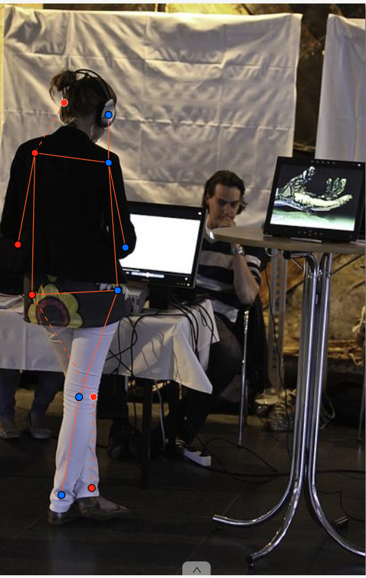
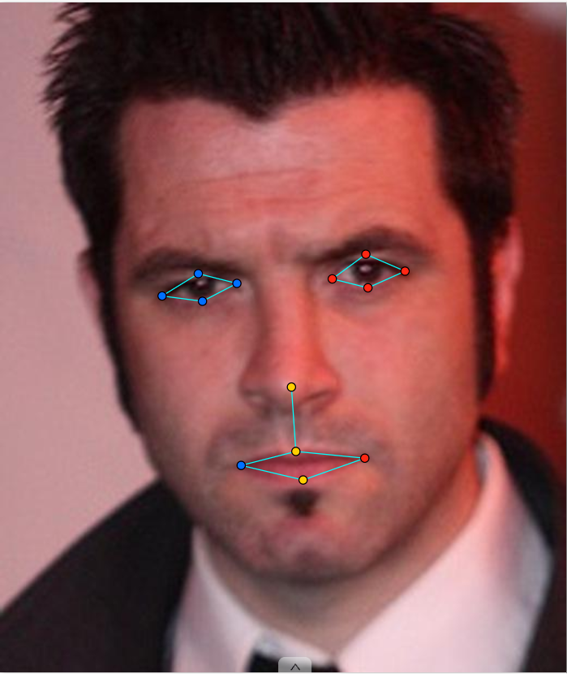
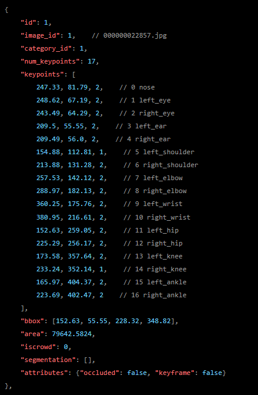

# Báo cáo cá nhân — NguyenSonTung (2A202603053)

Đổi tên file theo quy tắc `MSSV_HoTen.md`. Ví dụ: `20241234_NguyenVanAn.md`.

Dữ liệu: 12 ảnh người COCO 2017 train/val và 8 ảnh khuôn mặt được cắt từ ảnh COCO 2017, chỉ dùng trong lớp.

## 0. Thông tin học viên

- Họ tên: Nguyễn Sơn Tùng
- MSSV: 2A202603053
- Email: 26ai.tungns2@vinuni.edu.vn
- Link repository: https://github.com/sontung-aithucchien/K5-L2-DAY04-NguyenSonTung-2A202603053-KeypointPose
- Phiên bản CVAT (Help → About): CVAT local v2.74.1
- Máy: hệ điều hành Windows 11 · RAM 16 GB · chạy CVAT chế độ đầy đủ
- Bộ ảnh (`src/exports/assignment.json` do `lab.py setup` tạo): có 
- Giờ bắt đầu:
- Giờ kết thúc:

## 1. Kiểm tra label (CP0)

| Label | Kiểu | Số điểm | Tên điểm đúng bảng của lab? | Đúng thứ tự? | Số cạnh |
|---|---|---:|---|---|---:|
| `person` | Skeleton | 17 | Có | Có | 19 |
| `face` | Skeleton | 13 | Có | Có | 13 |

Mẫu `person` dựng theo người quay mặt về camera (các điểm `left_*` nằm bên phải khung mẫu)? Có.

Cách đổi cờ `occluded` / `outside` cho **một điểm** trên phiên bản CVAT này (một câu):

Rê chuột vào đúng điểm rồi nhấn `Q` để bật/tắt `occluded` (`v = 1`) hoặc `O` để bật/tắt `outside` (`v = 0`); cũng có thể chuột phải vào điểm và chọn cờ.

## 2. Số lượng đã gán và thời gian (CP1, CP2)

| Nhóm ảnh | Số ảnh | Số skeleton đã gán | Số người dưới 60 px (không gán) | Số poster / gương / màn hình bỏ qua | Thời gian (phút) |
|---|---:|---:|---:|---:|---:|
| `easy` | 5 | 5 | Chưa đếm riêng | Chưa đếm riêng | Không ghi lại |
| `occluded` | 3 | 4 | Chưa đếm riêng | Chưa đếm riêng | Không ghi lại |
| `back` | 2 | 2 | Chưa đếm riêng | Chưa đếm riêng | Không ghi lại |
| `small` | 1 | 1 | Chưa đếm riêng | Chưa đếm riêng | Không ghi lại |
| `crowd` | 1 | 2 | Chưa đếm riêng | Chưa đếm riêng | Không ghi lại |
| `faces` | 8 | 8 | — | — | Không ghi lại |

Số skeleton được thống kê từ hai file ZIP. Thời gian làm và số ảnh hoàn thành ở phút 105 không được ghi lại; số người dưới 60 px và số người trên poster, gương hay màn hình cũng chưa được đếm riêng.

Qua xem lại ảnh gốc, xác định có ít nhất 5 người thật cao từ 60 px chưa có skeleton: người ở nền trong `000000022857.jpg`, `000000106051.jpg`, `000000188804.jpg`, `000000393909.jpg` và `000000381889.jpg`. Các trường hợp này được ghi là `missing` trong bảng tự review.

- Số ảnh người hoàn thành ở phút 105: Không có ghi chép để xác định.
- Thời gian thực tế: Không ghi lại cho CP1, CP2 hoặc CP3.
- Ảnh tốn thời gian nhất và lý do: Không có ghi chép thời lượng để đối chiếu.

## 3. Bảng ca khó (CP1, CP2)

Mỗi điểm còn phân vân ghi một dòng, nhất là trường hợp phân vân giữa `v = 1` và `v = 0` hoặc chưa chắc hướng người.

| Ảnh | Người / mặt | Điểm | Cờ đã chọn | Phân vân giữa | Lý do chọn |
|---|---|---|---:|---|---|
| `000000043719.jpg` | Người #1 | Mũi/mắt | `v = 2` | `vis_flag` hay có thể ước lượng vị trí | Người quay lưng nên mặt không nhìn thấy; left nằm phía trái ảnh là phù hợp với tư thế quay lưng, không tự động swap toàn thân. Mắt/mũi đang xuất `v = 2`, cần chọn lại cờ. |
| `000000106051.jpg` | Người #1 | `left_eye`, `right_eye` | Cả hai `v = 2` | `lr_swap` cặp mắt | Cặp mắt bị đảo so với tai và các cặp thân; các cặp thân còn lại không nên đổi theo cảnh báo này. |
| `000000188804.jpg` | Người #1 | Mắt; cổ chân | `v = 2` | Đổi cặp mắt hay giữ do góc mặt; cổ chân có bắt chéo thật không | Cặp mắt ngược với tai/vai; chân bắt chéo trong ảnh có thể giải thích cảnh báo cổ chân. |
| `000000311497.jpg` | Người #2 | `right_eye`; gối/cổ chân | `v = 2` | `position` hoặc `lr_swap`; chân bắt chéo thật | Điểm `right_eye` nằm trên mũ, không trúng mắt; dáng bước có chân bắt chéo nên không tự động đổi gối/cổ chân. |
| `000000022857.jpg` | Người #1 | Hai tai | Cả hai `v = 2` | `position` hay `vis_flag`; cảnh báo hướng trái/phải | Ảnh nghiêng; hai tai gần như trùng tọa độ (209.50, 55.55 và 209.49, 56.00), cần xem lại điểm tai và cờ thay vì tự động swap cả người. |

## 4. Bảng tự review (CP3)

Đi từ ảnh cuối về ảnh đầu. 5 ảnh người (ít nhất 2 ảnh `back` hoặc `crowd`) và 3 ảnh mặt. Ít nhất 8 dòng, kể cả dòng `ok`. Ghi lỗi trước, sửa sau.

Mã lỗi dùng đúng một trong: `lr_swap`, `vis_flag`, `position`, `missing`, `extra`, `ok`.

| Ảnh | Người / mặt | Điểm | Mã lỗi | Ghi chú | Đã sửa? |
|---|---|---|---|---|---|
| `000000381889.jpg` | Người chưa gán | Skeleton người chụp ảnh ở nền | `missing` | Người thật ở nền cao trên 60 px, không phải người trong ảnh/màn hình; chưa có skeleton. | Chưa |
| `000000106051.jpg` | Người chưa gán | Skeleton người mặc áo xanh/tím ở giữa ảnh | `missing` | Người thật cao trên 60 px đứng cạnh ngựa; annotation hiện có là người cạnh ngựa đen. | Chưa |
| `000000106051.jpg` | Người #1 | Cặp mắt | `lr_swap` | Cặp mắt ngược phía so với tai và các cặp thân; chỉ xem lại cặp mắt. | Chưa |
| `000000043719.jpg` | Người #1 | Mũi/mắt | `vis_flag` | Mặt không nhìn thấy ở tư thế quay lưng nhưng mũi/mắt đang xuất `v = 2`; left/right trên thân phù hợp với hướng quay lưng, không swap toàn thân theo cảnh báo tự động. | Chưa |
| `000000022857.jpg` | Người chưa gán | Skeleton người ở nền bên trái | `missing` | Có người thật ở nền, cao trên 60 px; hiện chỉ có skeleton người đầu bếp tiền cảnh. | Chưa |
| `000000022857.jpg` | Người #1 | Hai tai | `position` | Hai điểm tai gần như trùng nhau; ảnh nghiêng nên xem lại tai xa và cờ hiển thị. | Chưa |
| `000000393909.jpg` | Người chưa gán | Skeleton người ngồi bên trái | `missing` | Người thật bị che một phần bởi ghế/sofa nhưng cao trên 60 px; chưa có skeleton. | Chưa |
| `000000311497.jpg` | Người #2 | `right_eye` | `position` | Điểm nằm trên mũ thay vì mắt; cần đặt lại và xem cờ hiển thị. | Chưa |
| `000000188804.jpg` | Người chưa gán | Skeleton người ngồi sau bàn | `missing` | Người thật ở nền, cao trên 60 px; skeleton hiện có là người đứng tiền cảnh. | Chưa |
| `000000188804.jpg` | Người #1 | Cặp mắt | `lr_swap` | Cặp mắt ngược với tai/vai; cổ chân bắt chéo có vẻ là tư thế thật, không swap cổ chân theo heuristic. | Chưa |
| `face_560526.jpg` | Mặt #1 | 13 điểm | `ok` | Các điểm mắt bị mũ che được gán `v = 1`; mũi/miệng nằm đúng vị trí. | Không cần |
| `face_219250.jpg` | Mặt #1 | 13 điểm | `ok` | Các điểm mắt sau kính được gán `v = 1`; các điểm mũi/miệng khớp ảnh. | Không cần |
| `face_504911.jpg` | Mặt #1 | 13 điểm | `ok` | Mắt, mũi, miệng nằm đúng các đặc trưng nhìn thấy. | Không cần |

Tổng số mục theo từng mã:

| `lr_swap` | `vis_flag` | `position` | `missing` | `extra` | `ok` |
|---:|---:|---:|---:|---:|---:|
| 2 | 1 | 2 | 5 | 0 | 3 |

Điểm còn phân vân giữa `v = 1` và `v = 0`:

Hai mắt của người quay lưng trong `000000043719.jpg` hiện được đặt `v = 2` dù không nhìn thấy. Annotation chưa được chỉnh trên CVAT; cần xem lại ảnh để quyết định có thể ước lượng vị trí (`v = 1`) hay không xác định được (`v = 0`).

## 5. Kiểm file xuất và kết quả tự kiểm (CP4)

Tự kiểm tay trong file JSON:

| File | Người / mặt kiểm (ảnh, thứ tự) | Số phần tử `keypoints` | Điểm `outside` ra `v = 0`, `occluded` ra `v = 1`? | `num_keypoints` khớp? |
|---|---|---:|---|---|
| `NguyenSonTung_persons.zip` | `000000022857.jpg` #1 | 51 | `v = 1` ra 1; không có `v = 0` để kiểm tra | Có |
| `NguyenSonTung_persons.zip` | `000000106051.jpg` #1 | 51 | `v = 1` ra 1; không có `v = 0` để kiểm tra | Có |
| `NguyenSonTung_faces.zip` | `face_219250.jpg` #1 | 39 | `v = 1` ra 1; không có `v = 0` để kiểm tra | Có |

Trong hai ZIP, các điểm `occluded` được xuất với `v = 1`. Không có điểm nào mang `v = 0`, nên chưa thể kiểm tra cách xuất `outside` hoặc tọa độ đi kèm.

Trạng thái completed của hai job chưa thể xác nhận từ file ZIP.

Dán phần **TÓM TẮT** in ra từ `src/check_submission.py`:

```text
=== src\exports\NguyenSonTung_persons.zip (label `person`) ===
  [CẢNH BÁO] 000000022857.jpg #1: thấy rõ mũi và hai mắt (v = 2) nhưng các điểm left nằm bên TRÁI ảnh, tức là gán như người quay lưng. Kiểm lại hướng người (`lr_swap` cả người?).
  [CẢNH BÁO] 000000043719.jpg #1: thấy rõ mũi và hai mắt (v = 2) nhưng các điểm left nằm bên TRÁI ảnh, tức là gán như người quay lưng. Kiểm lại hướng người (`lr_swap` cả người?).
  [CẢNH BÁO] 000000106051.jpg #1: cặp eye nằm ngược phía so với các cặp còn lại. Có thể đổi trái/phải một cặp (`lr_swap`), hoặc tay / chân bắt chéo thật: kiểm lại.
  [CẢNH BÁO] 000000188804.jpg #1: cặp eye, ankle nằm ngược phía so với các cặp còn lại. Có thể đổi trái/phải một cặp (`lr_swap`), hoặc tay / chân bắt chéo thật: kiểm lại.
  [CẢNH BÁO] 000000311497.jpg #2: cặp eye, knee, ankle nằm ngược phía so với các cặp còn lại. Có thể đổi trái/phải một cặp (`lr_swap`), hoặc tay / chân bắt chéo thật: kiểm lại.

=== src\exports\NguyenSonTung_faces.zip (label `face`) ===

----- TÓM TẮT (dán vào báo cáo mục 5) -----
- File person: NguyenSonTung_persons.zip
  Số ảnh: 12 · số skeleton `person`: 14 · mỗi annotation 51 số
  Skeleton theo ảnh: 000000022857=1, 000000043719=1, 000000106051=1, 000000162046=1, 000000188804=1, 000000194027=1, 000000201702=1, 000000311497=2, 000000349521=1, 000000381889=2, 000000393909=1, 000000399983=1
  Cờ v: v=2 212 (89%) · v=1 26 (11%) · v=0 0 (0%)
  num_keypoints trung bình: 17.0
- File face: NguyenSonTung_faces.zip
  Số ảnh: 8 · số skeleton `face`: 8 · mỗi annotation 39 số
  Skeleton theo ảnh: face_147624=1, face_219250=1, face_3348=1, face_380639=1, face_504911=1, face_505385=1, face_560526=1, face_79591=1
  Cờ v: v=2 88 (85%) · v=1 16 (15%) · v=0 0 (0%)
  num_keypoints trung bình: 13.0
- Số [LỖI]: 0 · số [CẢNH BÁO]: 5
Kết quả: ĐẠT (đọc lại từng cảnh báo ở trên)
```

Hai file COCO Keypoints trong `src/exports/` đã được kiểm tra bằng `check_submission.py`: không có lỗi định dạng và có 5 cảnh báo hình học. Script không phát hiện người bị bỏ sót, nhưng rà soát ảnh gốc cho thấy ít nhất 5 trường hợp cần bổ sung. Các điểm/cờ và skeleton cần xem lại được liệt kê ở mục 3–4; annotation trên CVAT chưa được chỉnh sửa. Cảnh báo ở cổ chân trong `000000188804.jpg` và ở gối/cổ chân trong `000000311497.jpg` có thể do tư thế bắt chéo thật nên không nên swap tự động.

Riêng `000000043719.jpg`, người trong ảnh quay lưng nên không nên tự động đổi trái/phải trên thân; điểm mũi và mắt đang `v = 2` dù không nhìn thấy. Những điểm cần xem lại khác đã được ghi trong bảng tự review.

## 6. Ảnh chụp màn hình

Bốn ảnh minh chứng được lưu trong `report/individual/images/`; nguồn ảnh và dữ liệu được ghi dưới từng ảnh.

### 6.1. Label `person`



Nguồn: `src/lab/labels_d04_keypoint.json` và `src/keypoint_schema.json`.

### 6.2. Người quay lưng và cờ visibility



Ảnh: `000000188804.jpg` (COCO train2017); annotation: `src/exports/NguyenSonTung_persons.zip` (COCO Keypoints 1.0).

### 6.3. Khuôn mặt phóng to vùng mắt



Ảnh: `face_147624.jpg`, crop từ COCO train2017; annotation: `src/exports/NguyenSonTung_faces.zip` (COCO Keypoints 1.0).

### 6.4. JSON export



Nguồn: annotation ảnh `000000022857.jpg` trong `annotations/person_keypoints_default.json` thuộc `src/exports/NguyenSonTung_persons.zip`.

## 7. Tự đánh giá

1. Lỗi mắc nhiều nhất và cách tránh lặp lại:

   Khi xem lại ảnh, phát hiện một số người thật ở nền bị bỏ sót; ngoài ra còn có điểm trái/phải và vị trí mắt cần sửa. Quy trình lần sau: trước khi kết thúc mỗi ảnh, quét khung hình từ trái sang phải, đếm người thật cao từ 60 px (không tính người trên màn hình, poster hoặc trong gương), rồi kiểm tra mỗi người có một skeleton.

2. Quy tắc đề xuất bổ sung vào guideline (kèm ảnh ví dụ nếu có):

   Nên thêm bước “kiểm đủ người trước khi kiểm điểm”: xác định từng người thật cao từ 60 px, gán một skeleton cho mỗi người, rồi mới rà trái/phải và cờ hiển thị. Với tư thế quay lưng hoặc nghiêng, cần dựa vào hướng cơ thể thay vì chỉ nhìn vị trí trên ảnh; mắt, tai không nhìn thấy cũng không nên để `v = 2`.

3. Nhãn keypoint đi vào model như thế nào? Ảnh hưởng của một lỗi đã phát hiện:

   Cặp mắt bị đảo trái/phải ở `000000106051.jpg` (chưa sửa) sẽ khiến heatmap mục tiêu của mắt trái nằm ở vị trí mắt phải và ngược lại. Khi lật ảnh để augment, nhãn sai này còn khiến quy tắc trái/phải của model thiếu nhất quán.

## 8. Khó khăn và lỗi kỹ thuật

`check_submission.py` báo 0 lỗi và 5 cảnh báo. Tuy vậy, rà soát ảnh gốc trong `data/persons/` cho thấy ít nhất 5 người thật cao từ 60 px chưa được gán. Ngoài các vấn đề về annotation đã nêu, không có log để xác nhận thêm lỗi kỹ thuật hoặc thời lượng thao tác.

## Bonus (nếu làm)

### B1 — 3 ảnh người khó thêm

Không tìm thấy dữ liệu B1 hoặc file `NguyenSonTung_bonus_persons.zip` trong workspace.

### B2 — 5 ảnh khuôn mặt đen trắng / hồng ngoại

Workspace hiện không có tệp hoặc kết quả B2 để đưa vào báo cáo.

### B3 — Model so với nhãn (không tính điểm)

- Demo đã dùng: Chưa ghi lại.
- Ảnh đã thử: Chưa ghi lại.

Model demo chưa được thử nên chưa có kết quả để nhận xét cho các câu dưới đây.

1. Model có trả điểm cho khớp bị che, hay khớp ngoài ảnh không? Confidence ở các điểm đó thế nào?

   Chưa có kết quả confidence để báo cáo.

2. Với người quay lưng, model có đổi trái/phải không?

   Chưa có kết quả để nhận xét.

3. Bộ điểm của model có giống 17 điểm COCO không?

   Chưa có kết quả để nhận xét.

## 9. Tài liệu tham khảo và công cụ AI đã dùng

### Tài liệu
- Lin et al. (2014), Microsoft COCO: https://cocodataset.org/
- Ảnh người và ảnh mặt crop: COCO 2017 train/val; thông tin giấy phép và nguồn từng ảnh tại `src/lab/NGUON_ANH.md` và `src/lab/pool.json`.
- Ảnh COCO 2017 theo giấy phép CC BY 2.0 / CC BY-SA 2.0; CVAT local v2.74.1, định dạng xuất COCO Keypoints 1.0 và CVAT for images 1.1.
- Công cụ tự kiểm của bài: `src/check_submission.py`; schema: `src/keypoint_schema.json`.

### Công cụ AI
- Copilot SDK trong VS Code: hỗ trợ đối chiếu file xuất, rà ảnh và kiểm tra báo cáo.